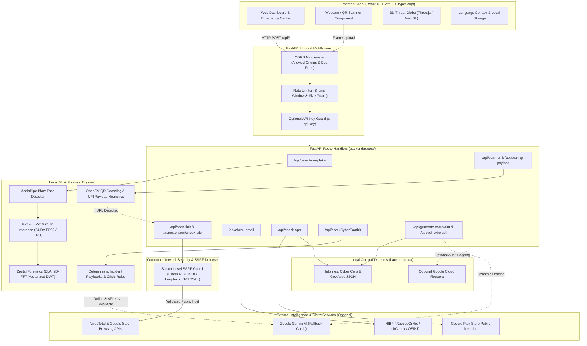

# Veyron

**AI-Powered Cybersecurity Intelligence & Citizen Protection Platform**

*Proactive Threat Detection, Digital Forensics, and Incident Response for Citizens and Developers.*

---

## Overview

Modern digital threats—ranging from synthetic media impersonations and credential leaks to deceptive payment schemes and weaponized links—frequently exploit the gap between complex enterprise security tools and everyday digital citizens.

**Veyron** is an integrated cybersecurity intelligence platform designed to bridge this divide. It consolidates digital forensics, real-time heuristic scanning, threat intelligence feeds, and automated incident response into a unified single-pane interface. By coupling local machine learning inference with practical citizen playbooks, Veyron enables individuals and technical operators to screen suspicious media, inspect hostile links, verify deceptive QR codes, evaluate leaked identities, and generate formal legal complaints without requiring specialized cybersecurity expertise.

> **Disclaimer:** Veyron provides automated risk assessments, heuristic screening, and educational guidance. Its outputs are probabilistic indicators rather than judicial proof or absolute security guarantees. In active emergencies or severe financial fraud, users should immediately engage designated law enforcement authorities.

---

## Architecture

Veyron follows a modular client-server architecture balancing responsive client-side interactions with robust server-side inspection and local machine learning inference.



---

## Key Features

### 1. Deepfake & Synthetic Media Authentication
- **Multi-Signal Image Forensics:** Employs a layered verification pipeline for still images (JPEG, PNG, WebP) combining deep vision models and signal processing.
- **Vision Transformers & CLIP:** Leverages Hugging Face's `umm-maybe/AI-image-detector` alongside `openai/clip-vit-base-patch32` for semantic alignment and generative artifact scoring.
- **MediaPipe BlazeFace Isolation:** Automatically isolates and normalizes face regions using `blaze_face_short_range.tflite` to prevent background confusion.
- **Digital Forensic Algorithms:** Executes Error Level Analysis (ELA) for compression anomalies, 2D Fast Fourier Transform (FFT) for periodic generative noise, and Discrete Wavelet Transform (DWT) co-occurrence accumulation via vectorized NumPy.
- **Hardware Acceleration:** Native CUDA FP32 precision support on NVIDIA GPUs with serialized concurrency controls (`asyncio.Semaphore(1)`).
- **Debug Image Storage Policy:** Deepfake debug image storage is disabled by default (VEYRON_DEBUG_FACES=false), so normal analysis does not save uploaded or derived images. For local debugging only, explicitly set VEYRON_DEBUG_FACES=true in ackend/.env. This writes intermediate images and heatmaps under debug_outputs/ for inspection; successful debug artifacts are retained until manually removed. If analysis fails, artifacts created by that operation are removed. Uploaded and downloaded processing files are temporary and cleaned up after analysis. Do not enable this option in production.
- *Operational Scope:* Still image authentication only. Video files trigger an explicit advisory noting that temporal optical-flow tracking is required; audio analysis is not supported.

### 2. Link Scanner & Outbound SSRF Protection
- **URL Normalization:** Strips tracking parameters (`utm_*`, `fbclid`, `gclid`) and parses canonical hostname targets.
- **Multi-Source Reputation:** Integrates with VirusTotal and Google Safe Browsing APIs when keys are configured.
- **Socket-Level SSRF Defense:** Enforces strict socket checks before outbound requests, blocking private address spaces (RFC 1918), loopback interfaces, link-local subnets, and cloud metadata endpoints (e.g., `169.254.169.254`).
- **Heuristic Threat Engine:** Analyzes domain Shannon entropy, suspicious TLD patterns, punycode spoofing, and redirect chains when offline or unconfigured.

### 3. QR Shield (Deceptive Payment & URL Defense)
- **OpenCV Computer Vision:** In-browser camera scanning and file decoding via `cv2.QRCodeDetector` and `QRCodeDetectorAruco` with CLAHE contrast enhancement and Otsu thresholding.
- **UPI Payment Threat Heuristics:** Parses `upi://pay` strings to inspect parameters including payee VPA, claimed payee name, preset transfer amount, and transaction notes. Flags social-engineering triggers ("refund", "kyc", "lottery", "cashback") and brand mimicry.
- **Critical Payment Security Clarification:** Anyone can generate and display a QR code to receive money. Scanning a UPI payment QR code with a camera or scanner does not automatically transfer funds; completing a transaction requires the user to open a UPI application and authorize it with their secret UPI PIN. Fraudsters exploit this misunderstanding by convincing victims that scanning a code or entering their PIN is necessary to "receive" refunds or prize money.
- *Operational Scope:* Strictly diagnostic and advisory. Payee names extracted from QR strings represent raw payload text and are not independently verified against banking records. Veyron does not authorize, initiate, or process financial transactions.

### 4. Email Breach Checker
- **Breach Aggregation:** Queries Have I Been Pwned (HIBP) and secondary intelligence providers (XposedOrNot, LeakCheck, ProxyNova, and Holehe OSINT) to identify credential leak history.
- **Disposable Email Detection:** Flags temporary and disposable inbox domains using a local curated catalog (`disposable_domains.json`).
- **Guided Remediation:** Outlines actionable recovery measures categorized by exposure type (plain passwords, salted hashes, financial identifiers).

### 5. App Authenticity Checker
- **Impersonation Detection:** Compares input names and package strings against verified brands (e.g., WhatsApp, Instagram, Google Pay, PhonePe, Paytm).
- **Government App Directory:** Deterministic offline validation against official Indian public digital services (`government_apps.json` covering DigiLocker, UMANG, mAadhaar, CoWIN).
- **Google Play Store Validation:** Fetches public metadata (ratings, install counts, developer identity) via `google-play-scraper`.
- *Operational Scope:* Evaluates public store metadata and developer records. Does not decompile, execute, or cryptographically verify raw `.apk` binaries.

### 6. CyberSaathi Multilingual Assistant
- **Conversational Guidance:** Powered by Google Gemini (`gemini-flash-lite-latest`, `gemini-3.5-flash-lite`, `gemini-3.5-flash`, `gemini-3.8-flash`, `gemini-2.5-flash`) with in-process rate-limit cooldown caching.
- **Emergency Offline Playbooks:** Deterministic rule-based recovery paths for UPI fraud, cyber extortion/sextortion, identity theft, and account compromise when offline or unconfigured.
- **Distress & Crisis Intervention:** Integrated sentiment detection triggers support hotlines when self-harm or severe psychological distress is detected.
- **Bilingual Interface:** Real-time localization in English, Hindi, and Hinglish.

### 7. Cybercrime Complaint Hub & Cyber Cell Locator
- **Legal Draft Generator:** Automatically structures formal cybercrime complaints aligned with the Indian Information Technology Act (Sections 66C, 66D, 66E, 67) and the Bharatiya Nyaya Sanhita (BNS) / IPC for submission to [cybercrime.gov.in](https://cybercrime.gov.in) or local police stations.
- **Geospatial Cyber Cell Locator:** Identifies the nearest specialized police cyber cell via GPS (Haversine formula) or state selection, providing station contacts and physical addresses.
- **Verified Directory:** Pre-loaded directory of national helplines (1930 Cyber Fraud Helpline, 112 Unified Emergency, 1091 Women Safety).

### 8. Interactive 3D Threat Globe
- **WebGL Visualization:** Built with Three.js, `@react-three/fiber`, and `react-globe.gl` using high-resolution local textures (`earth-dark-cyber.jpg`, `earth-night.jpg`, `earth-topology.png`).
- **Performance Optimized:** Viewport DPR clamped to 1.75 with low-power WebGL settings to ensure smooth rendering on standard desktop hardware.
- *Operational Scope:* Displays curated telemetry vectors and procedural trajectory arcs for contextual visualization; does not represent live, unverified attack feeds.

---

## Veyron Pro: Coming Soon

Veyron Pro is a planned premium personal cybersecurity experience built around proactive protection, identity monitoring, device security and live AI assistance.

| Pillar | Planned Capability | Status |
| :--- | :--- | :--- |
| **CyberSaathi Connect** | Real-time, interruptible two-way conversational voice guidance with AI assistance during active fraud or scam calls. | `PLANNED / COMING SOON` |
| **Veyron Web Shield** | Proactive browser extension defense blocking malicious websites, drive-by downloads, and deceptive links with user-controlled settings. | `PLANNED / COMING SOON` |
| **Veyron Identity Watch** | Continuous identity exposure monitoring across verified datasets with authorized assisted removal requests and separately scoped specialist escalation. | `PLANNED / COMING SOON` |
| **Veyron Device Guard** | Lightweight endpoint monitor inspecting system integrity, suspicious file downloads, and antivirus/firewall status with guided remediation. | `PLANNED / COMING SOON` |

> *Note: All four pillars above are planned capabilities and are not currently functional. Core citizen security features (Deepfake Detector, Link Scanner, QR Shield, Breach Checker, App Verifier, Complaint Hub) remain 100% free and open for public safety.*

---

## Technology Stack

| Layer | Technologies | Purpose |
| :--- | :--- | :--- |
| **Frontend UI** | React 18, Vite 5, TypeScript 5, Tailwind CSS | Single-page responsive interface and reactive state management |
| **Animations & Icons** | Framer Motion, Lucide React | Visual transitions, micro-interactions, and accessibility icons |
| **3D Graphics** | Three.js, `@react-three/fiber`, `react-globe.gl` | Hardware-accelerated interactive globe visualization |
| **Backend API** | FastAPI, Uvicorn, Python 3.11+ / 3.13 | Asynchronous REST API and background worker pools |
| **Data Validation** | Pydantic v2, Pydantic-Settings | Strict request/response validation and configuration management |
| **Vision & ML** | PyTorch, Hugging Face `transformers`, SafeTensors | Deepfake image classification and CLIP semantic verification |
| **Face Analysis** | MediaPipe BlazeFace (`tasks_vision` / `solutions`) | Automated face boundary detection and landmark cropping |
| **Digital Forensics** | OpenCV, Pillow, NumPy, SciPy | ELA, 2D Fast Fourier Transform, and DWT co-occurrence matrices |
| **AI Assistant** | Google GenAI SDK (`google-genai`), Gemini Models | Multilingual cybersecurity assistant and complaint drafting |
| **Store & Intelligence** | `google-play-scraper`, Requests, Cachetools | Play Store metadata scraping, HTTP connection pooling, and caching |
| **Persistence (Optional)**| Local JSON datasets, Firebase Admin SDK | Offline databases for helplines/cyber cells; optional Firestore logging |

---

## Installation & Local Development

### Prerequisites
- **Node.js**: v18.0.0 or higher
- **Python**: v3.11.0 to v3.13.x
- **Git**: Installed and configured
- **Optional**: NVIDIA GPU with CUDA drivers (for local deepfake acceleration)

### Step 1: Clone the Repository
`ash
git clone https://github.com/vaibhavgarg364-tech/cyber-app.git
cd cyber-app
`


### Step 2: Configure Environment Variables
Create a `.env` file in the `backend/` directory by copying the template:

```powershell
copy backend\.env.example backend\.env
```

Open `backend\.env` and configure your API keys (all keys are optional; the platform falls back to offline heuristics when keys are absent):

| Environment Variable | Requirement | Description |
| :--- | :--- | :--- |
| `GEMINI_API_KEY` | Optional | Google Gemini API key for CyberSaathi chatbot and dynamic complaint drafting. |
| `VIRUSTOTAL_API_KEY` | Optional | VirusTotal API key for live URL scanning. |
| `SAFE_BROWSING_API_KEY` | Optional | Google Safe Browsing API key for phishing and malware domain verification. |
| `HIBP_API_KEY` | Optional | Have I Been Pwned API key for email breach lookups (uses public fallbacks if omitted). |
| `ALLOWED_ORIGINS` | Optional | Comma-separated list of allowed frontend origins (defaults to local Vite ports). |
| `BACKEND_API_KEY` | Optional | Shared token checked in `x-api-key` header to restrict expensive endpoints in deployment. |
| `APP_ENV` | Optional | Application environment (`development`, `staging`, `production`). Default: `development`. |
| `LOG_LEVEL` | Optional | Logging verbosity (`DEBUG`, `INFO`, `WARNING`, `ERROR`). Default: `DEBUG`. |
| `FIREBASE_CREDENTIALS_PATH` | Optional | File path to Firebase service account JSON for persistent Firestore audit logs. |
| `FIREBASE_PROJECT_ID` | Optional | Firebase project identifier. |
| `VEYRON_OFFLINE_MODELS` | Optional | Set to `1` or `true` to force Hugging Face models to load strictly from local cache. |

*(Optional frontend variable in root `.env`: `VITE_BACKEND_API_URL` defaults to `http://127.0.0.1:8000/api`)*

### Step 3: Setup Backend Environment
In a dedicated terminal, create and activate the Python virtual environment in `backend/.venv`:

- **Windows PowerShell:**
  ```powershell
  cd backend
  python -m venv .venv
  .\.venv\Scripts\Activate.ps1
  pip install -r requirements.txt
  ```

- **Windows Command Prompt (CMD):**
  ```cmd
  cd backend
  python -m venv .venv
  .venv\Scripts\activate.bat
  pip install -r requirements.txt
  ```

### Step 4: Setup Frontend Dependencies
In a second terminal from the repository root:

```powershell
npm install
```

### Step 5: Start the Development Servers

#### Option A: Unified Concurrent Startup (Recommended)
From the repository root with the backend virtual environment activated in your terminal:
```powershell
# Activate backend venv from repository root (PowerShell)
.\backend\.venv\Scripts\Activate.ps1

# Launch both backend and frontend concurrently
npm run dev
```
*`npm run dev` invokes `concurrently` to run `npm run backend` (`python -m uvicorn main:app --reload --host 127.0.0.1 --port 8000` from `backend/`) and `npm run frontend` (`vite --host 127.0.0.1 --port 5173`) simultaneously.*

#### Option B: Separate Terminal Startup
- **Backend Terminal:**
  ```powershell
  cd backend
  .\.venv\Scripts\Activate.ps1
  python -m uvicorn main:app --reload --host 127.0.0.1 --port 8000
  ```
- **Frontend Terminal (Repository Root):**
  ```powershell
  npm run frontend
  ```

### Step 6: Access the Platform
- **Frontend Web Application:** [http://127.0.0.1:5173](http://127.0.0.1:5173)
- **Interactive OpenAPI Documentation:** [http://127.0.0.1:8000/docs](http://127.0.0.1:8000/docs)
- **Backend Health Check:** [http://127.0.0.1:8000/health](http://127.0.0.1:8000/health)

---

## Usage Guide

### Deepfake Image Verification
1. Navigate to **Deepfake Detector** from the navigation bar or `#/deepfake`.
2. Upload a suspected face image (JPEG, PNG, or WebP).
3. The platform processes the image across MediaPipe BlazeFace, Hugging Face ViT, CLIP alignment, and frequency analysis (ELA/FFT/DWT).
4. Review the overall confidence percentage, visual anomaly indicators, and forensic explanation breakdown.

### Hostile URL & Link Scanning
1. Navigate to **Link Scanner** (`#/scanner`).
2. Paste any unknown link or shortened URL received via SMS, WhatsApp, or email.
3. The scanner normalizes the URL, checks socket-level SSRF boundaries, queries threat reputation APIs, and calculates domain entropy.
4. Review the safety verdict, redirect indicators, and domain age before opening the target.

### QR Shield Payment Verification
1. Open **QR Shield** (`#/qrshield`) and allow browser camera permissions or upload a QR image/screenshot.
2. The scanner decodes the QR matrix and determines the payload type (UPI, URL, Wi-Fi, vCard, or Plain Text).
3. For UPI strings, review extracted parameters (payee VPA, claimed name, preset amount) and highlighted social-engineering warnings ("refund", "kyc", "lottery").
4. Remember that scanning a QR code with a camera does not deduct funds, and Veyron never initiates payments.

### Email Breach Screening
1. Open **Breach Checker** (`#/spam`).
2. Enter an email address to audit.
3. Review associated historical breach events, exposure dates, and compromised data classes (passwords, phone numbers, addresses).
4. Follow the step-by-step guidance to rotate passwords and activate Multi-Factor Authentication (MFA).

### App Authenticity Verification
1. Open **App Checker** (`#/app`).
2. Enter an application title or Google Play Store package identifier.
3. The platform cross-references verified government catalogs, checks brand impersonation, and evaluates store ratings and install metrics.

### Official Complaint Drafting
1. Navigate to **Complaint Hub** (`#/complaints`).
2. Provide a factual summary of the incident, transaction details, and location.
3. Generate a structured legal narrative cross-referenced with applicable IT Act and BNS/IPC sections.
4. Copy the generated draft for submission to the National Cyber Crime Reporting Portal ([cybercrime.gov.in](https://cybercrime.gov.in)) or local law enforcement.

---

## Testing & Verification

The repository includes test suites covering frontend components, end-to-end API contracts, scanner security, and forensic inference.

### Run Frontend Tests
From the repository root:
```powershell
# Execute Jest test suite (unit and component contracts)
npm test

# Run TypeScript static type checking
npm run typecheck

# Run ESLint validation
npm run lint

# Verify production bundle compilation
npm run build
```

### Run Backend Tests
Backend unit and integration tests use `pytest`. Ensure `pytest` is installed in your Python environment:

```powershell
# Install pytest in the active virtual environment if needed
pip install pytest
```

Execute tests from the repository root:

- **Using Activated Environment (PowerShell):**
  ```powershell
  .\backend\.venv\Scripts\Activate.ps1
  python -m pytest tests/
  ```

- **Using Activated Environment (CMD):**
  ```cmd
  backend\.venv\Scripts\activate.bat
  python -m pytest tests/
  ```

- **Direct Path Execution:**
  ```powershell
  backend\.venv\Scripts\python.exe -m pytest tests/
  ```

- **Targeted Test Commands:**
  ```powershell
  # Fast API endpoint smoke tests
  python -m pytest tests/test_endpoint_smoke.py

  # QR Shield heuristic & decoding tests
  python -m pytest tests/test_qr_shield.py

  # SSRF boundary defense tests
  python -m pytest tests/test_ssrf_protection.py

  # Link Scanner hardening tests
  python -m pytest tests/test_link_scanner_hardening.py
  ```

*Note: Passing automated tests validates application logic, API formatting, and regression resilience; it does not constitute formal commercial security certification.*

---

## Security, Privacy & Limitations

| Aspect | Platform Reality & Policy |
| :--- | :--- |
| **Probabilistic ML Verdicts** | Deepfake detection algorithms and forensic filters output confidence estimations. They should be treated as advisory screening signals and independently verified. |
| **Supported Media Types** | Deepfake forensic analysis operates on still images (JPEG, PNG, WebP). Video and audio temporal analysis are not supported. |
| **Zero-Day Phishing Domains** | Link scanner heuristics flag high-entropy and suspicious URL structures, but brand new zero-day domains absent from threat feeds may show neutral ratings. |
| **Financial Isolation** | QR Shield is strictly a passive diagnostic tool. It cannot transfer funds, execute UPI intents, or access banking credentials. |
| **Breach Dataset Coverage** | Breach checks search indexed, public databases. The absence of breach records does not guarantee an account has never been targeted in private or unindexed breaches. |
| **Data Handling & Transmission** | Veyron does not collect or solicit banking passwords or PINs. Uploaded deepfake images are written to temporary files during analysis and unlinked upon completion. When external APIs are configured, relevant target queries (URLs for VirusTotal, emails for HIBP, prompts for Gemini) are transmitted over secure HTTPS to their respective providers. |
| **Backend API Key Scope** | The optional `BACKEND_API_KEY` setting acts as an internal rate-mitigation filter via the `x-api-key` header on expensive endpoints; it does not constitute full user identity management or role-based access control. |
| **Incident Response Advisory** | CyberSaathi provides educational triage and self-help steps; it is not an emergency dispatcher. If experiencing financial fraud, citizens should immediately contact their bank to block payment channels and report the incident via the National Cyber Crime Helpline at `1930` or [cybercrime.gov.in](https://cybercrime.gov.in). |

---

## Repository Structure

```
Veyron/
├── backend/
│   ├── data/                    # Pre-loaded databases (helplines, cyber cells, gov apps)
│   ├── models/                  # Local ML models (blaze_face_short_range.tflite)
│   ├── routes/                  # FastAPI routers and engine implementations
│   │   ├── chatbot.py           # CyberSaathi AI router and fallback chains
│   │   ├── compliance.py        # Complaint generator & cyber cell geospatial lookup
│   │   ├── deepfake_pipeline.py # Deepfake vision pipeline (ViT, CLIP, ELA, FFT, DWT)
│   │   ├── detectors.py         # Main scanner endpoints (Email, App, Deepfake)
│   │   ├── qr_engine.py         # OpenCV QR decoder and UPI heuristic analyzer
│   │   ├── utils.py             # SSRF defenses, emotion detection, and helpers
│   │   └── website_scanner.py   # URL normalizer, VirusTotal & Safe Browsing client
│   ├── config.py                # Pydantic settings and Firebase store abstraction
│   ├── main.py                  # ASGI server entry point, rate limiting, and CORS
│   ├── requirements.txt         # Python dependencies
│   └── .env.example             # Backend environment template
├── public/
│   └── textures/                # WebGL textures for 3D Cyber Globe
├── src/
│   ├── __tests__/               # Frontend Jest and React Testing Library suites
│   ├── components/              # Shared UI components and 3D globe visualizations
│   │   ├── 3d/                  # Three.js CyberGlobe and ambient shaders
│   │   ├── premium/             # Cinematic canvas backgrounds
│   │   ├── CyberSaathi.tsx      # CyberSaathi interactive chat widget
│   │   └── Navbar.tsx / Footer.tsx
│   ├── context/                 # LanguageContext for bilingual support
│   ├── pages/                   # Application views
│   │   ├── AppChecker.tsx       # Mobile app authenticity view
│   │   ├── Awareness.tsx        # Citizen educational guides
│   │   ├── ComplaintHub.tsx     # Cybercrime complaint drafter & helplines
│   │   ├── DeepfakeDetector.tsx # Media authentication interface
│   │   ├── Emergency.tsx        # Rapid incident triage view
│   │   ├── Home.tsx             # Main dashboard
│   │   ├── LinkScanner.tsx      # URL and phishing inspector
│   │   ├── QRShield.tsx         # QR scanning and payload analyzer
│   │   ├── RootCause.tsx        # Scam anatomy analysis
│   │   ├── SpamChecker.tsx      # Email breach assessment
│   │   └── VeyronPro.tsx        # Pro pillars interface
│   ├── api.js / api.d.ts        # Typed API communication client
│   ├── App.tsx                  # Root application router and layout
│   └── index.css                # Tailwind styling
├── tests/                       # Pytest test suite and test fixtures
├── package.json                 # Node.js dependencies and scripts
├── tsconfig.json                # TypeScript compiler configuration
└── vite.config.ts               # Vite configuration and backend API proxy
```

---

## License & Project Status

- **Project Status:** Hackathon Demonstration Build.
- **License Notice:** All rights reserved. Intellectual property and source code rights remain with the author and maintainers. Refer to repository owners for licensing inquiries, evaluation terms, or collaborative deployment permissions.
